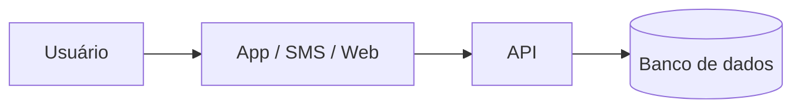

## 3. Estrutura exigida para o documento

### Moderação automatizada e transparência: entre o controle do discurso e o direito de saber (Dossiê 5)

* Bruno Rodrigues | dev-rodrigues-bruno | Analista de Dados | 48101541
* Caio Dal Pizzol Fonseca | caio-fonseca | Engenharia de Software | 47923121
* Denner de Paula Coutinho | denner-coutinho | Analista de Dados | 48094030
* João Vitor Pires Ribeiro | Joaovp07 | Engenheiro de Software | 47792591 
* Nicollas Guedes Da Silva Santos | Nicollas-Guedes | Analista de Dados | 48131334

### Abertura

Todos os dias, bilhões de publicações circulam pelas plataformas digitais — e uma fração enorme delas é removida, rebaixada ou sinalizada sem que nenhum ser humano as tenha visto. A moderação de conteúdo deixou de ser uma tarefa manual para se tornar, em grande medida, uma operação automatizada, conduzida por algoritmos capazes de analisar textos, imagens e vídeos em escala e velocidade impossíveis para equipes humanas. Essa automação resolve um problema real: sem ela, as plataformas seriam inviáveis diante do volume de informação produzido. Mas ela também cria um problema novo e delicado — o de decisões que afetam diretamente a liberdade de expressão, o acesso à informação e a reputação das pessoas sendo tomadas por sistemas cujo funcionamento é, na prática, opaco para quem está sujeito a eles.

É nesse ponto que a transparência se torna central. Saber como, por que e com base em quais critérios um conteúdo é moderado não é apenas uma curiosidade técnica: é condição para que usuários possam contestar decisões, para que a sociedade possa fiscalizar o poder das plataformas e para que se construa confiança nesses espaços. Este trabalho busca compreender a tensão entre a eficiência da moderação automatizada e a exigência de transparência, discutindo seus desafios, seus limites e os caminhos possíveis para conciliá-las.

### 3.1 Análise do problema
* Quem é afetado, onde e quanto, **com dados e fontes**.
* Causas, com destaque para as **causas tecnológicas**: que sistemas, dados,
  redes ou decisões de projeto contribuem para o problema hoje.
* O que já existe (serviços públicos, aplicativos, iniciativas) e por que não
  basta.

### 3.2 Proposta tecnológica
* O que a solução é, para quem, e como funciona, passo a passo, do ponto de
  vista do usuário.
* **Arquitetura:** os componentes principais e como se conectam (um diagrama é
  bem-vindo: imagem no repositório ou Mermaid no próprio .md), que dados entram,
  onde ficam e quem acessa.
* **O trabalho de cada área em detalhe:** o que os profissionais das áreas
  representadas no grupo (Engenharia de Dados, Ciência de Dados, Cloud,
  Cibersegurança, Redes ou Gestão) fazem para essa solução existir e
  funcionar, e como esses trabalhos se complementam.
* **O que a tecnologia não resolve:** o que continua dependendo de ação
  humana, de política pública ou de outra área.

### 3.3 Análise ética
Refaçam, **para a solução de vocês**, o método do Comitê de Ética de 05/10:
* **Matriz de riscos** com no mínimo 5 riscos, cada um com classificação
  (ético, legal/privacidade, segurança, viés/inclusão ou governança), impacto
  (quem é afetado e quão grave) e controle.
* **Decisão** (implantar, implantar com controles ou não implantar ainda), com
  justificativa de até 10 linhas.
* **Controles antes de entrar em produção**, no mínimo 6, cobrindo os seis
  eixos: transparência, revisão humana, minimização de dados, segurança, teste
  de viés e canal de contestação. Cada controle diz **quem faz** e **como saber
  que foi cumprido**.
* **LGPD:** que dados pessoais a solução trata, com qual finalidade e base
  legal, por quanto tempo, e se há dados sensíveis ou de crianças e
  adolescentes.
* **Comunicado público** de até 600 caracteres explicando a solução e seus
  limites, como se fosse publicado no LinkedIn da consultoria (informe a
  contagem de caracteres).

### 3.4 Acessibilidade e inclusão digital
* Quem pode ficar de fora da solução (sem smartphone, sem internet, idoso,
  pessoa com deficiência, baixa escolaridade) e o que a proposta faz por cada
  grupo.
* Requisitos de acessibilidade concretos, com base nas diretrizes WCAG e no
  material da aula Inclusão Digital e Acessibilidade.

### 3.5 Sustentabilidade
* Impacto ambiental da própria solução (energia de servidores e modelos de IA,
  hardware, descarte) e escolhas para reduzi-lo, com base na aula sobre TI
  Verde.
* Sustentabilidade do projeto: quem mantém, quem paga, o que acontece depois
  do primeiro ano.

### 3.6 Impacto esperado
* Como o grupo vai saber se funcionou: **indicadores** mensuráveis, com meta.
* Como os usuários serão ouvidos **antes** de a solução ser ampliada.
* Riscos de a solução não pegar e o que fazer nesse caso.

### 3.7 Quadro de decisões
Uma tabela com as **principais decisões do projeto** (no mínimo 5), cada uma com a
decisão tomada, as alternativas consideradas e o motivo da escolha. Exemplos:
nuvem ou servidor próprio, aplicativo ou SMS, modelo próprio ou pronto, que
dados coletar e quais não coletar.

| Decisão | Alternativas consideradas | Por que escolhemos esta |
|---|---|---|

### 3.8 Capítulos individuais (um por integrante)
* **Papel no projeto:** pelo que o aluno respondeu e o que produziu (os
  commits dele devem confirmar).
* **Plano de desenvolvimento:** que competências, técnicas e comportamentais,
  esta solução exige de alguém na posição dele; quais ele já tem e quais faltam;
  metas **SMART** para os próximos 6 a 12 meses.
* **Feedback dos colegas**, ao final de cada capítulo: avaliação construtiva e
  propositiva coletiva dos demais integrantes sobre o papel e o plano do colega.

### 3.9 Referências
* Todas as fontes citadas, com link, publicadas **nos últimos 2 anos** (a
  partir de novembro de 2024). Leis e normas valem pela versão vigente.

---

## 4. Arguição (16 de novembro)

Na devolutiva, o professor faz uma arguição **grupo a grupo** sobre o
trabalho escrito:
* **Arguição do grupo (0,5):** perguntas sobre a proposta como um todo.
* **Arguição individual (1,0):** cada aluno responde sobre o trabalho, não só
  sobre o próprio capítulo. Quem não souber explicar a proposta que assinou
  perde esta parte.

Ausência na arguição sem justificativa zera a parte individual do aluno. Só são aceitas justificativas que seriam aceitas em ambiente profissional (CLT).

---

## 5. Esqueleto do documento

Copiem o esqueleto abaixo para o `.md` do repositório e troquem o que está
entre colchetes. Mantenham os títulos e a ordem das seções. A seção *N* do
esqueleto corresponde ao item 3.*N* desta orientação, que diz o que cada uma
deve conter. As tabelas trazem uma linha de exemplo; acrescentem quantas
forem necessárias.

# [Título claro e específico da proposta]

## Integrantes

| Nome completo (ordem alfabética) | GitHub | Área de carreira | RGM |
|---|---|---|---|
| [Nome] | [@usuario] | [Área] | [RGM] |

**Dossiê:** [número e título]
**Recorte:** [público, região ou etapa, com a justificativa; ou "sem recorte"]

## 1. Análise do problema

### 1.1 Quem é afetado, onde e quanto

A moderação automatizada de conteúdo impacta diretamente bilhões de usuários
de plataformas digitais globalmente e no Brasil, com efeitos desproporcionais
sobre criadores de conteúdo, ativistas, minorias representativas e pequenos
empreendedores.

- **Volume de conteúdo afetado:** estima-se que as principais plataformas de
  redes sociais removam proativamente mais de 100 milhões de conteúdos por
  trimestre por meio de filtros automatizados. Contudo, relatórios de
  transparência decorrentes do *Digital Services Act* (DSA) revelam que
  centenas de milhares de decisões de moderação por IA envolvem falsos
  positivos diariamente.
- **Impacto no Brasil:** pesquisas do *InternetLab* e do *CGI.br / NIC.br*
  apontam que usuários no Brasil enfrentam retenção indevida de contas e
  restrição silenciosa de alcance (*shadowbanning*) sem notificação detalhada.
  A supermoderação atinge desproporcionalmente o contradiscurso, a sátira e
  dialetos regionais.
- **Danos econômicos e liberdade de expressão:** empreendedores dependentes
  de comércio social perdem receitas imediatas ao sofrerem bloqueios de conta
  não fundamentados, enquanto o devido processo digital é cerceado pela
  ausência de canais de apelação eficientes.

### 1.2 Causas

As falhas de moderação automatizada decorrem de fatores estruturais e,
prioritariamente, de escolhas e limitações arquiteturais de tecnologia:

1. **Efeito caixa-preta (*black box*) dos modelos:** o uso de redes profundas
   (NLP/LLMs) impede a rastreabilidade da decisão. O sistema classifica uma
   publicação como "violação de diretrizes", mas não fornece o motivo lógico
   ou o trecho exato.
2. **Vieses de treinamento e incompetência contextual:** algoritmos são
   treinados com conjuntos de dados (*datasets*) predominantemente anglófonos
   ou centralizados, incapazes de discernir ironia, linguagem figurada, gírias
   locais e ressignificação de termos.
3. **Limitações de correspondência de hash:** filtros de assinaturas digitais
   (*hashes* exatas ou perceptuais) falham diante de conteúdos inéditos ou
   ligeiramente modificados e não avaliam o contexto em que a mídia foi
   compartilhada (por exemplo, denúncia de um crime versus apologia ao crime).
4. **Pipeline de apelação automatizado:** para reduzir custos operacionais,
   algumas plataformas utilizam os mesmos algoritmos classificadores para
   julgar os recursos dos usuários, eliminando a revisão humana qualificada.

### 1.3 O que já existe e por que não basta

- **Filtros de heurística e classificadores nativos:** plataformas utilizam
  algoritmos próprios baseados em inteligência artificial generativa e
  aprendizado de máquina para triagem em tempo real. **Por que não basta:**
  operam sob segredo industrial, sem transparência algorítmica, auditoria
  externa ou explicabilidade ao usuário afetado.
- **Portais legados de denúncia:** sistemas de notificação e retirada
  (*notice and take-down*) dependentes de denúncias de usuários.
  **Por que não basta:** sofrem com coordenação de ataques (*brigading*), falta
  de feedback transparente sobre a decisão final e demora no processamento
  manual de apelações.
- **Estruturas de autorregulação das plataformas:** conselhos de segurança e
  relatórios voluntários de transparência. **Por que não basta:** apresentam
  métricas agregadas que escondem taxas reais de erro e falsos positivos, além
  de carecerem de conformidade com normas de devido processo digital, como o
  DSA europeu e as exigências em debate no PL 2630/2020 e no artigo 19 do
  Marco Civil da Internet no Brasil.

## 2. Proposta tecnológica

### 2.1 A solução, do ponto de vista do usuário
[O que é, para quem, e como funciona passo a passo]

### 2.2 Arquitetura

[Que dados entram, onde ficam e quem acessa]

### 2.3 O trabalho de cada área

#### [Área 1]
#### [Área 2]
#### Como as áreas se complementam

### 2.4 O que a tecnologia não resolve

## 3. Análise ética

### 3.1 Matriz de riscos (mínimo 5)

| # | Risco | Classificação | Impacto (quem e quão grave) | Controle |
|---|---|---|---|---|
| 1 | | [ético / legal-privacidade / segurança / viés-inclusão / governança] | | |

### 3.2 Decisão
**[Implantar | Implantar com controles | Não implantar ainda]**
[Justificativa em até 10 linhas]

### 3.3 Controles antes de entrar em produção

| Eixo | Controle | Quem faz | Como saber que foi cumprido |
|---|---|---|---|
| Transparência | | | |
| Revisão humana | | | |
| Minimização de dados | | | |
| Segurança | | | |
| Teste de viés | | | |
| Canal de contestação | | | |

### 3.4 LGPD

| Dado pessoal | Finalidade | Base legal | Por quanto tempo | Sensível ou de criança/adolescente? |
|---|---|---|---|---|
| | | | | |

### 3.5 Comunicado público

> [Texto de até 600 caracteres para o LinkedIn da consultoria]

**Contagem:** [N] caracteres

## 4. Acessibilidade e inclusão digital

### 4.1 Quem pode ficar de fora

| Grupo | Barreira | O que a solução faz |
|---|---|---|
| | | |

### 4.2 Requisitos de acessibilidade
[Requisitos concretos, com o critério WCAG correspondente]

## 5. Sustentabilidade

### 5.1 Impacto ambiental da solução

O processamento de inteligência artificial para moderação em larga escala
impõe uma expressiva pegada ecológica que demanda estratégias de *Green AI*:

- **Consumo energético de data centers:** a inferência contínua em tempo real
  usando modelos de grande porte (LLMs) gera consumo elétrico intensivo e
  altas emissões de CO₂ em infraestruturas de nuvem.
- **Pegada hídrica e descarte de hardware (*e-waste*):** o resfriamento de
  servidores de GPU/TPU consome recursos hídricos significativos, enquanto a
  rápida substituição de hardware de aceleração acelera o acúmulo de lixo
  eletrônico.
- **Escolhas tecnológicas de TI verde para mitigação:**
  - **Arquitetura de filtragem em camadas:** uso de algoritmos de baixo custo
    energético (*hashing* e regras heurísticas) na primeira etapa de triagem,
    acionando modelos complexos de NLP/LLM apenas para conteúdos limítrofes.
  - **Destilação de modelos (*model distillation*):** emprego de modelos
    compactos (*Small Language Models* — SLMs) otimizados para inferência
    local, com redução estimada de até 90% no consumo energético por
    requisição.
  - **Provedores com energia renovável:** hospedagem em data centers com
    certificação PUE otimizada e alimentados por fontes 100% renováveis.

### 5.2 Sustentabilidade do projeto

A perenidade da solução envolve sustentabilidade operacional, financeira e
humana:

- **Quem mantém:** equipe técnica multidisciplinar composta por Engenheiros
  de Dados (manutenção do pipeline e dos datasets), Especialistas em
  Cibersegurança/Privacidade (conformidade com a LGPD e auditoria de APIs) e
  moderadores humanos de apoio para casos de apelação.
- **Sustentabilidade humana e social:** estabelecimento de jornadas de
  trabalho controladas, rotação de tarefas e suporte contínuo de saúde mental
  para revisores humanos terceirizados, evitando a superexposição a conteúdos
  nocivos e garantindo o trabalho digno na cadeia de suprimentos de IA.
- **Modelo financeiro:** custeio viabilizado por taxa de governança de
  conformidade cobrada de plataformas integradas, fundos institucionais de
  fomento à transparência algorítmica ou parcerias público-privadas de
  interesse social.
- **Após o primeiro ano:** transição para um modelo de governança aberta e
  multissetorial (*open source*, com API de auditoria para pesquisadores
  acadêmicos do *Data Privacy Brasil*, *InternetLab* e *ITS Rio*), garantindo
  atualizações contínuas de segurança e reavaliação periódica dos modelos de
  viés.

## 6. Impacto esperado

### 6.1 Indicadores

| Indicador | Como medir | Meta | Prazo |
|---|---|---|---|
| | | | |

### 6.2 Como os usuários serão ouvidos
### 6.3 Se a solução não pegar

## 7. Quadro de decisões (mínimo 5)

| Decisão | Alternativas consideradas | Por que escolhemos esta |
|---|---|---|
| | | |

## 8. Capítulos individuais

### 8.1 [Nome do integrante] — [Área]

**Papel no projeto:** [pelo que respondeu e o que produziu]

**Plano de desenvolvimento**

| Competência que a solução exige | Técnica ou comportamental | Já tenho? |
|---|---|---|
| | | |

**Metas SMART (6 a 12 meses)**
1. [Específica, mensurável, atingível, relevante e com prazo]

**Feedback dos colegas**
[Avaliação construtiva e propositiva, escrita em conjunto pelos demais integrantes]

### 8.2 [Próximo integrante] — [Área]
### 8.3 [Próximo integrante] — [Área]
### 8.4 [Próximo integrante (se houver)] — [Área]
### 8.5 [Próximo integrante (se houver)] — [Área]

## 9. Referências

- [Autor ou órgão]. *[Título]*. [Veículo], [data]. [link]
